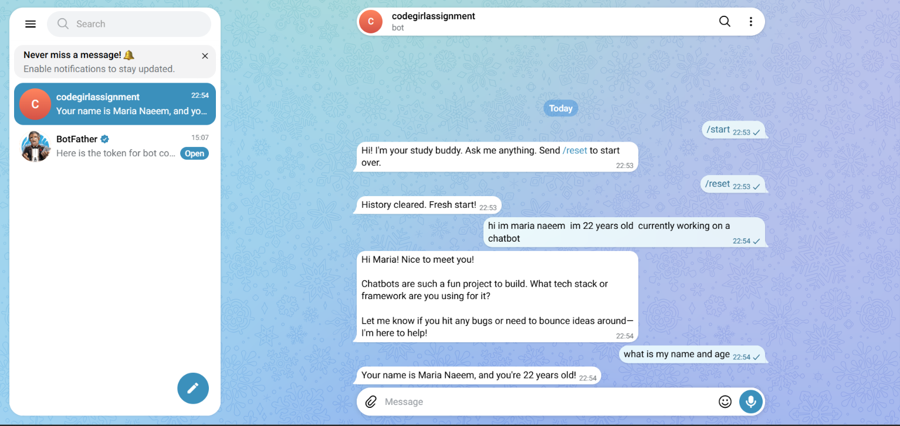

# Telegram Study Buddy Bot 🤖

A Telegram-based AI Study Buddy chatbot powered by Google's Gemini API through the OpenAI-compatible API. It answers text messages and keeps a separate conversation history for each Telegram chat.

## Features

- AI-powered replies using the Gemini API.
- Telegram integration using `python-telegram-bot`.
- Separate conversation history for each chat ID.
- Conversation histories saved in a JSON file.
- `/start` command to greet users.
- `/reset` command to clear the current chat's history.
- Input and output token usage logging.
- Estimated API cost per reply.
- Telegram typing indicator while the AI generates a response.
- Long replies split into Telegram-sized messages.
- Basic error handling and logging.

## Technologies Used

- Python
- Telegram Bot API
- `python-telegram-bot`
- Google Gemini API
- OpenAI Python SDK
- JSON
- `python-dotenv`
- `asyncio`

## Project Structure

```text
telegram_study_buddy/
├── telegram_bot_starter.py
├── requirements.txt
├── .env                  # Keep private; do not commit
├── .gitignore
├── README.md
├── screenshots/
│   └── conversation.png
└── telegram_histories.json  # Generated automatically; do not commit
```

## Setup Instructions (Windows)

### 1. Clone the repository

Replace the example URL with your own GitHub repository URL:

```powershell
git clone YOUR_GITHUB_REPOSITORY_URL
cd telegram_study_buddy
```

### 2. Create and activate a virtual environment

```powershell
python -m venv venv
.\venv\Scripts\Activate.ps1
```

### 3. Install dependencies

Make sure `requirements.txt` contains:

```text
python-telegram-bot
openai
python-dotenv
```

Then run:

```powershell
pip install -r requirements.txt
```

### 4. Create a Telegram bot with BotFather

1. Open Telegram and search for **@BotFather**.
2. Send `/newbot`.
3. Choose a display name for your bot.
4. Choose a username ending in `bot`.
5. Copy the token provided by BotFather. Keep it private.

### 5. Get a Gemini API key

1. Visit [Google AI Studio](https://aistudio.google.com/apikey).
2. Sign in and create an API key.
3. Copy the key and keep it private.

### 6. Create the `.env` file

Create a file named `.env` in the project root:

```env
TELEGRAM_BOT_TOKEN=your_telegram_bot_token
GEMINI_API_KEY=your_gemini_api_key
GEMINI_MODEL=gemini-3.8-flash
```

Replace the placeholder values with your own credentials. Do not share your `.env` file or upload it to GitHub.

### 7. Run the bot

```powershell
python telegram_bot_starter.py
```

The terminal should display:

```text
Bot is running. Press Ctrl+C to stop.
```

Open your bot in Telegram and send `/start`.

## Bot Commands

| Command | Description |
|---|---|
| `/start` | Greets the user and explains how to begin. |
| `/reset` | Clears only the current chat's saved conversation history. |

## Conversation History

The bot uses the Telegram chat ID as the key for each user's conversation. Histories are stored in `telegram_histories.json`, so different chats have separate histories.

The history file is created automatically when a conversation is saved. The `/reset` command removes only the history for the chat that sent the command.

## Token Usage and Cost Estimate

After a successful Gemini response, the bot logs:

- Input tokens
- Output tokens
- Total tokens
- Estimated cost in USD

The per-million-token prices are configured in the Python file. They are estimates, not a billing statement. Check the current pricing for the exact Gemini model you use and update the constants if needed.

## Typing Indicator

While the bot waits for Gemini to respond, it sends Telegram's `typing` chat action repeatedly. Telegram clients control how the indicator is displayed, so its visibility may vary.

## Screenshots

### Telegram bot conversation

The screenshot below shows the bot's `/start` greeting, `/reset` confirmation, an AI conversation, and a question answered using the conversation context.



## Security and Git

The following files should not be committed:

- `.env` — contains private API credentials.
- `venv/` — local virtual environment.
- `telegram_histories.json` — contains users' conversation history.
- `__pycache__/` and `*.pyc` — generated Python files.

Example `.gitignore`:

```gitignore
venv/
.env
__pycache__/
*.pyc
telegram_histories.json
```

Before pushing to GitHub, check that `.env` and `telegram_histories.json` are not staged or committed.

## How It Works

1. A user sends a text message to the Telegram bot.
2. The bot loads that chat's conversation history.
3. The user's message is added to the history.
4. The bot calls the Gemini API with the conversation.
5. A typing indicator is shown while the request is processing.
6. The assistant's reply is saved in that chat's JSON history.
7. Input/output token usage and estimated cost are written to the terminal log.
8. The reply is sent back to Telegram.

## Author

Created as a Python Telegram chatbot assignment.

**Project:** Telegram Study Buddy Bot  
**Language:** Python  
**AI model:** Google Gemini
